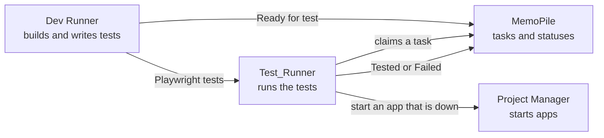
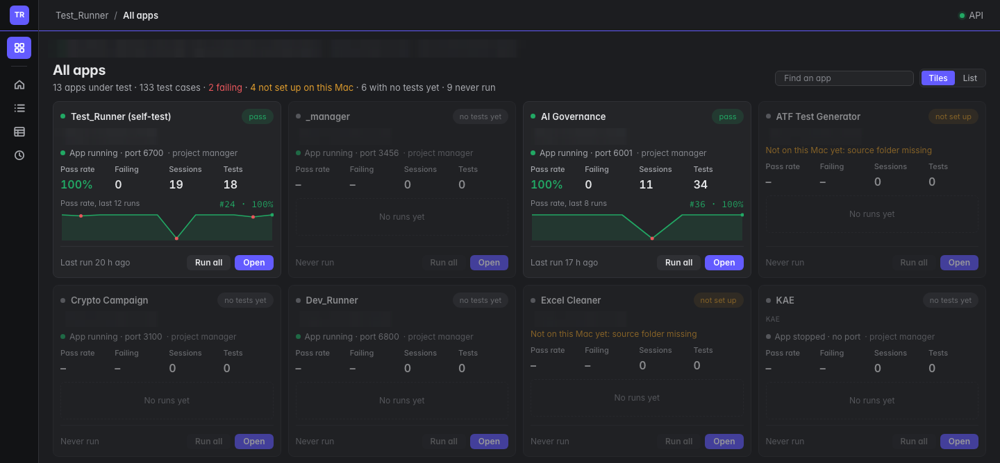
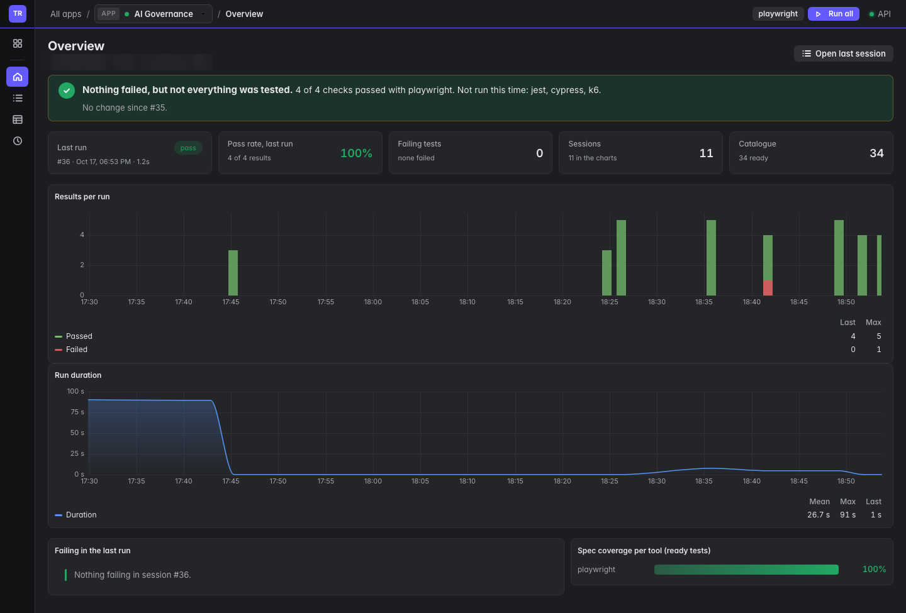
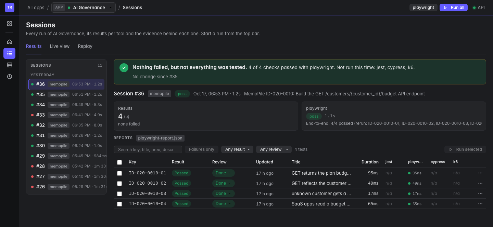
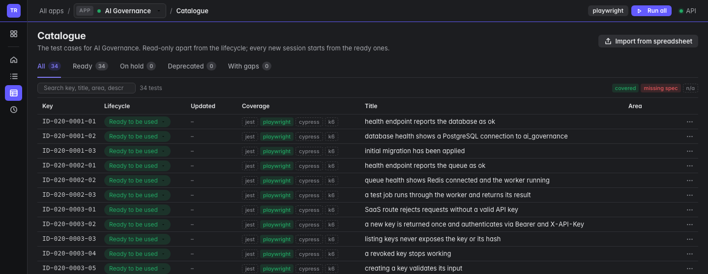
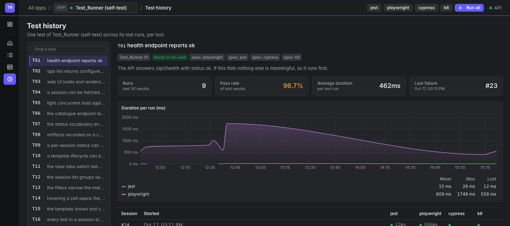
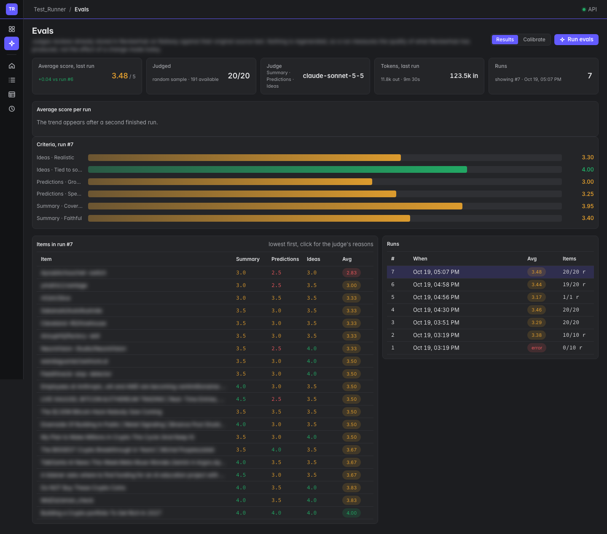
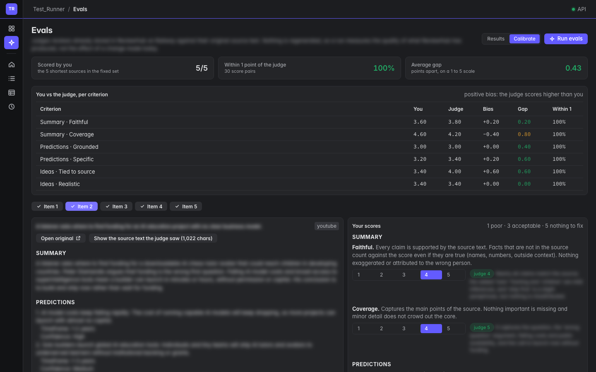

# Test_Runner

Tests every app from one place. It runs Playwright, Cypress, Jest and k6 against an app and keeps every result with its history, so a failure shows how long it has been failing, not just that it failed. It also picks up tasks from MemoPile and reports each one back as Tested or Failed, and runs evals that score the quality of an app's AI output with an LLM judge.

> **Source code is private.** This repository shows what Test_Runner does and how it is built. The code is available on request.

## Why

Tests spread across many apps and tools quietly stop being run. Test_Runner keeps them in one place, runs them for every task an AI agent builds, and keeps the history so a regression is visible the moment it appears.

## The flow with MemoPile

1. **Ready for test.** Dev Runner (or a person) sets a task to Ready for test in MemoPile.
2. **Claim.** Test_Runner checks MemoPile's queue every 30 seconds and claims one task; MemoPile moves it to Testing and locks it.
3. **Only that task's tests.** Each test is keyed to the task it belongs to, so a run checks exactly what the task changed.
4. **App down?** Test_Runner asks Project Manager to start it and waits for it to answer.
5. **Report back.** The task moves to **Tested** or **Failed** with a one-line verdict and a link to the run. A person still closes a Tested task, and decides what happens to a Failed one.

Runs started by hand (run all, one tool, or selected tests) work the same way, without MemoPile.

## Screenshots

Real screens; app names and test details are blurred.

| | |
|---|---|
|  |  |
| **All apps**: every app under test with its pass rate, failing tests and a pass-rate sparkline | **Overview**: one app's verdict, last run, failing tests and charts per run |
|  |  |
| **Sessions**: every run with results per tool and the evidence behind each test | **Catalogue**: the app's test cases and their lifecycle |
|  |  |
| **Test history**: one test followed across its runs, per tool | **Evals**: AI output quality scored 1 to 5 by an LLM judge, per criterion and per run |
|  | |
| **Calibrate**: a person scores items blind, then sees the judge's scores beside theirs | |

## Highlights

- **Evals**: tests check the app works; evals check how good its AI output is. An LLM judge scores a random sample of real outputs against their source on a rubric per part (for example faithfulness, coverage, specificity), with a one-line reason for every score, and the averages are tracked run over run so a prompt or model change shows up as a number. Any app plugs in with a small config and adapter.
  - **Fixed set**: every run judges the same items, so a score change means a quality change, not a different sample.
  - **Calibrated judge**: a person scores a handful of items blind on the same rubric. After tightening the rubric, judge and human agree within 1 point on every score.
  - **Prompt A/B**: the app regenerates the fixed set with a prompt change through an eval-only endpoint (nothing saved) and the result is judged against the baseline, so prompt changes ship on evidence, not gut feel.
  - **Monthly drift check**: a scheduled run regenerates and judges the fixed set to catch model or prompt drift.
- **Live view** streams the test browser while Playwright drives the app, and **Replay** steps through a finished test's trace.
- **Import from spreadsheet**: Claude Code reads any test spreadsheet, talks through what to take from it and proposes test cases. Nothing is written until they are approved.
- **Draft tests**: Claude Code writes test code for catalogue cases.
- **Command line harness** with clear exit codes (passed, failed, app unreachable) and a preflight check that catches problems which otherwise fail quietly.

## How it is built

| Part | Technology |
|---|---|
| Web app | React and Vite UI, Express API |
| Test tools | Playwright, Cypress, Jest and k6 |
| Data | SQLite: sessions, results per tool, evidence and full history |
| AI | Claude Code for spreadsheet import and drafting tests; Claude Sonnet as the eval judge |
| Runs on | A Mac, started by Project Manager, with optional scheduled runs |

## Part of a pipeline

- [**MemoPile**](https://github.com/man-pi/memopile-showcase): the AI task pile that feeds the pipeline
- [**Dev Runner**](https://github.com/man-pi/dev-runner-showcase): builds tasks with Claude Code and writes their tests
- [**Project Manager**](https://github.com/man-pi/project-manager-showcase): knows every app and starts it
- [**Mission Control**](https://github.com/man-pi/mission-control-showcase): shows all of them side by side

## Licence

Copyright (c) 2026 man-pi. All rights reserved. The screenshots and text in this repository may not be reused without permission.
